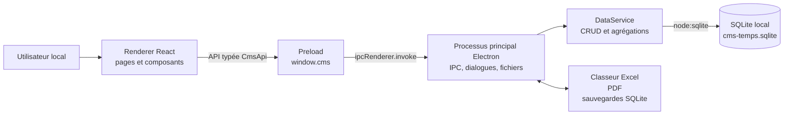
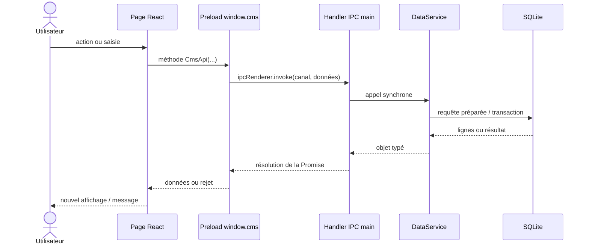
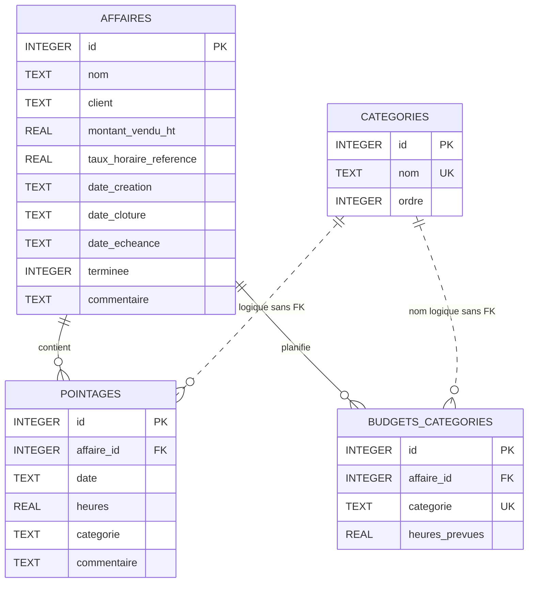
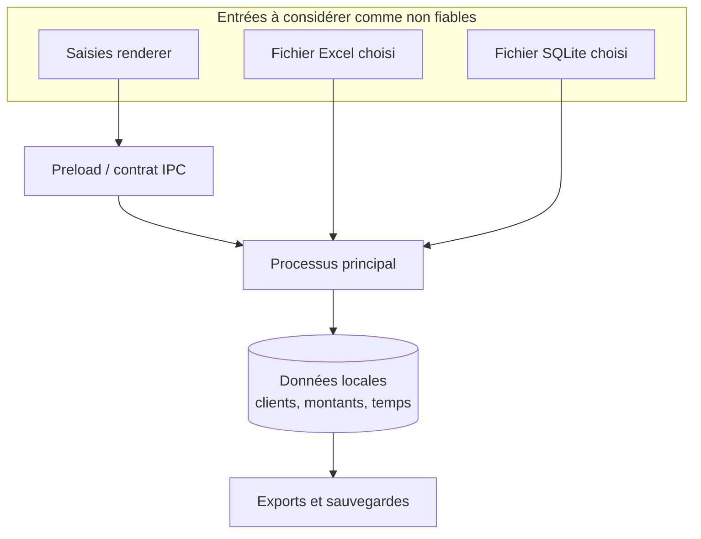

# Architecture de CMS Temps

> État observé le 13 novembre 2026 sur le commit `3b82f65` (version applicative `1.3.0`).
> Ce document décrit le dépôt tel qu'il existe ; il ne constitue pas une spécification cible.

## Convention de lecture

- **Fait** : comportement ou choix directement vérifiable dans le dépôt. Le chemin source est cité.
- **Déduction** : interprétation raisonnable, explicitement signalée, à partir de plusieurs faits observés.
- **Non trouvé** : élément recherché mais absent du dépôt au moment de l'analyse.
- **Recommandation** : évolution proposée ; elle ne décrit pas l'existant.

Les chemins sont relatifs à la racine du dépôt.

## 1. Vue d'ensemble

### Objectif

**Fait.** CMS Temps est une application de bureau locale de suivi d'affaires au forfait. Elle permet d'enregistrer les affaires, de pointer du temps, de répartir un budget d'heures par type de tâche, de calculer la consommation et la rentabilité, puis d'importer, d'exporter et de sauvegarder les données. La description du produit et les fonctions principales sont visibles dans `README.md`; les objets métier et les calculs sont définis dans `src/shared/types.ts`, `src/shared/calculations.ts` et `src/main/services/data-service.ts`.

**Fait.** Le fonctionnement normal ne dépend d'aucun serveur applicatif : la base est un fichier SQLite placé dans le répertoire `userData` d'Electron et toutes les opérations sont exécutées dans le processus principal (`src/main/index.ts`, `src/main/database/index.ts`). L'accès à Internet n'est requis que pour installer les dépendances, récupérer `fnm` dans le script Windows et publier/télécharger les artefacts GitHub ; il n'est pas requis à l'exécution de l'application installée (`scripts/installer-windows.ps1`, `.github/workflows/release-windows.yml`).

### Utilisateurs et cas d'usage

**Déduction.** L'interface, les libellés et l'absence de comptes montrent une application mono-utilisateur destinée à la personne qui gère et réalise les affaires. Aucun rôle distinct n'est modélisé.

Principaux cas d'usage observés :

1. créer, modifier, terminer ou supprimer une affaire ;
2. saisir un pointage isolé ou une semaine de pointages ;
3. consulter les crédits d'heures, le taux réel, les alertes et les prévisions ;
4. définir les budgets par catégorie et administrer les catégories ;
5. consulter le tableau de bord, dont le CA produit par mois ou par année ;
6. produire un rapport PDF par affaire ;
7. importer/exporter un classeur Excel ;
8. sauvegarder ou restaurer la base SQLite.

Ces parcours sont routés dans `src/renderer/src/App.tsx` et mis en œuvre dans `src/renderer/src/pages/`.

### Style architectural observé

**Fait.** Il s'agit d'une application Electron monolithique, locale et en couches :

- une couche de présentation React dans le renderer ;
- un pont restreint exposé par le preload ;
- un processus principal Electron qui orchestre les fenêtres, l'IPC et les fichiers ;
- un service métier/accès aux données reposant sur SQLite embarqué.

**Déduction.** `DataService` cumule les responsabilités de dépôt SQL, validation métier partielle et agrégation de tableau de bord. L'architecture est donc en couches, mais pas une architecture hexagonale stricte : la logique applicative dépend directement de `DatabaseSync` (`src/main/services/data-service.ts`).



Sources : `src/renderer/src/App.tsx`, `src/main/preload.ts`, `src/main/index.ts`, `src/main/services/data-service.ts`, `src/main/database/index.ts`.

## 2. Structure du dépôt

### Carte du projet

| Chemin | Rôle observé |
|---|---|
| `src/renderer/` | Application Web embarquée : HTML, entrée React, routes, pages, composants et styles Tailwind. |
| `src/main/` | Processus principal Electron, preload, accès SQLite, migrations et services applicatifs. |
| `src/shared/` | Types échangés entre renderer et main, catégories initiales et calculs métier purs. |
| `tests/` | Tests Vitest des calculs, des catégories et des migrations SQLite. |
| `scripts/` | Préparation du format de modules Electron et automatisation Windows. |
| `.github/workflows/` | Construction et publication de l'installateur Windows par GitHub Actions. |
| `resources/` | Dossier présent mais vide ; aucun actif de packaging n'y est actuellement versionné. |
| `dist/` | Sortie renderer générée par Vite, ignorée par Git. |
| `dist-electron/` | JavaScript main/preload compilé, ignoré par Git. |
| `release/` | Paquets générés par `electron-builder`, ignorés par Git. |
| `docs/` | Documentation d'architecture maintenue avec le code. |

Sources : arborescence du dépôt, `.gitignore`, `vite.config.ts`, `tsconfig.node.json`, `package.json`.

### Organisation

**Fait.** Le dépôt contient une seule application et un seul manifeste racine `package.json`. `pnpm-workspace.yaml` ne déclare aucun package ; il ne contient qu'une autorisation de script de construction pour `electron-winstaller`. `src/package.json` ne constitue pas un package autonome : il fixe uniquement `type: commonjs` dans l'arbre source.

**Déduction.** Malgré la présence d'un fichier nommé `pnpm-workspace.yaml`, le dépôt n'est pas un monorepo fonctionnel. Renderer, main et code partagé sont trois zones du même paquet.

### Points d'entrée

| Point d'entrée | Fonction |
|---|---|
| `src/main/index.ts` | Démarre Electron, ouvre la base, enregistre les handlers IPC et crée la fenêtre. |
| `src/main/preload.ts` | Expose `window.cms` au renderer via `contextBridge`. |
| `src/renderer/index.html` | Document HTML chargé par Vite/Electron. |
| `src/renderer/src/main.tsx` | Monte React dans `#root` et active `HashRouter`. |
| `src/renderer/src/App.tsx` | Déclare les routes fonctionnelles. |

Le `HashRouter` et `base: './'` rendent la navigation compatible avec un fichier `index.html` chargé depuis le système de fichiers (`src/renderer/src/main.tsx`, `vite.config.ts`).

### Commandes importantes

| Commande | Effet |
|---|---|
| `pnpm install --frozen-lockfile` | Installe exactement les versions verrouillées ; commande utilisée en CI. |
| `pnpm dev` | Compile main/preload, démarre Vite, attend le port 5173 et lance Electron avec `VITE_DEV_SERVER_URL`. |
| `pnpm typecheck` | Vérifie séparément renderer/tests et main/shared sans émission. |
| `pnpm test` | Exécute tous les tests Vitest une fois. |
| `pnpm test:watch` | Exécute Vitest en mode interactif. |
| `pnpm build` | Compile les deux mondes, construit le renderer, puis produit les paquets de la plateforme hôte. |
| `pnpm build:win` | Produit l'installateur NSIS Windows x64. |
| `pnpm build:dir` | Produit un répertoire non empaqueté pour diagnostic. |
| `INSTALLER-WINDOWS.cmd` | Lance l'automatisation PowerShell d'installation, de vérification et de build Windows. |

Sources : `package.json`, `INSTALLER-WINDOWS.cmd`, `scripts/installer-windows.ps1`.

## 3. Technologies et outils

### Socle applicatif

Les versions ci-dessous sont celles résolues dans `pnpm-lock.yaml`; plusieurs contraintes du manifeste sont volontairement `latest`.

| Élément | Version verrouillée | Rôle précis |
|---|---:|---|
| TypeScript | 7.0.2 | Typage strict commun au renderer, au main et aux tests ; deux configurations séparent les cibles navigateur et Node. |
| Electron | 45.3.0 | Conteneur bureau, cycle de vie, fenêtres, dialogues système, impression PDF et IPC. |
| React / React DOM | 19.3.1 | Rendu déclaratif de l'interface dans le renderer. |
| React Router DOM | 7.18.5 | Routage local par hash entre les écrans. |
| SQLite via `node:sqlite` | fourni par Node/Electron | Stockage local synchrone sans module natif externe. |
| Vite | 8.3.8 | Serveur de développement et bundle du renderer. |
| Tailwind CSS | 3.4.17 | Classes utilitaires et thème visuel ; PostCSS et Autoprefixer transforment la feuille finale. |
| Recharts | 3.10.1 | Graphiques du tableau de bord. |
| SheetJS `xlsx` | 0.18.5 | Lecture et écriture des classeurs d'import/export. |
| Lucide React | 1.72.0 | Icônes de l'interface. |
| electron-builder | 26.18.0 | Packaging DMG/ZIP macOS et NSIS x64 Windows. |
| Vitest | 5.1.0 | Tests unitaires et d'intégration SQLite. |

Sources : `package.json`, `pnpm-lock.yaml`, imports dans `src/main/index.ts` et `src/renderer/src/pages/DashboardPage.tsx`.

### Gestion des paquets et build

**Fait.** pnpm est le gestionnaire reproductible de fait : un seul `pnpm-lock.yaml` est versionné, la CI installe pnpm 11.18.0 et appelle `pnpm install --frozen-lockfile` (`.github/workflows/release-windows.yml`).

**Fait.** La construction est en deux sorties :

1. `tsc -p tsconfig.node.json` émet le main et le preload dans `dist-electron/` ;
2. `scripts/prepare-electron.mjs` y écrit un `package.json` avec `type: commonjs`, nécessaire car la racine est ESM ;
3. Vite produit le renderer dans `dist/` ;
4. electron-builder inclut `dist/**/*`, `dist-electron/**/*` et `package.json`.

Sources : `tsconfig.node.json`, `scripts/prepare-electron.mjs`, `vite.config.ts`, `package.json`.

### Qualité

| Outil | Usage observé |
|---|---|
| TypeScript `strict` | Vérification statique des deux environnements via `pnpm typecheck`. |
| Vitest | Tests sous `tests/**/*.test.ts`. |
| GitHub Actions | Réexécute installation figée, typage, tests et build Windows. |

**Non trouvé.** Aucun ESLint, Prettier, hook de commit, rapport de couverture ou outil d'analyse statique supplémentaire n'est configuré. Il n'existe pas de commande `lint` ou `format` dans `package.json`.

### Infrastructure, distribution et services externes

- **Fait.** Aucun conteneur, orchestrateur, hébergement Web ou base distante n'est présent.
- **Fait.** GitHub Actions construit Windows lors d'un déclenchement manuel ou d'un tag `v*.*.*`. Un tag publie l'EXE dans GitHub Releases ; un lancement manuel conserve l'EXE comme artefact (`.github/workflows/release-windows.yml`).
- **Fait.** Le packaging macOS (`dmg`, `zip`) est configuré, mais aucun workflow macOS n'est présent (`package.json`).
- **Fait.** Le script Windows télécharge éventuellement `fnm` depuis GitHub, installe Node 22 et pnpm, vérifie le projet et construit l'EXE (`scripts/installer-windows.ps1`).
- **Non trouvé.** Aucun outil de télémétrie, suivi d'erreurs, métriques, traces ou collecte centralisée de logs.
- **Non trouvé.** Aucune configuration de signature Windows, de signature/notarisation macOS ou de mise à jour automatique.

## 4. Architecture applicative

### Renderer React

**Responsabilité.** Afficher l'état, collecter les saisies, appliquer quelques validations de formulaire et appeler l'API `window.cms`. Il n'accède ni à SQLite ni au système de fichiers.

| Route | Écran | Responsabilité principale |
|---|---|---|
| `/` | `DashboardPage.tsx` | Indicateurs, alertes, heures mensuelles, rentabilité et CA produit mois/année. |
| `/affaires` | `AffairesPage.tsx` | Liste, recherche, filtres et création. |
| `/affaires/:id` | `AffaireDetailPage.tsx` | Détail, statistiques, prévision, budgets, pointages et rapport PDF. |
| `/pointages/nouveau` | `PointageFormPage.tsx` | Création ou modification d'un pointage. |
| `/semaine` | `SemainePage.tsx` | Saisie groupée du lundi au vendredi pour les affaires actives. |
| `/categories` | `CategoriesPage.tsx` | Création, renommage, remplacement et suppression des types de tâche. |
| `/donnees` | `DonneesPage.tsx` | Import/export Excel, sauvegarde et restauration SQLite. |

Sources : `src/renderer/src/App.tsx`, `src/renderer/src/pages/`.

**Fait.** L'état est local aux composants avec `useState`/`useEffect`. Les données sont rechargées depuis le main après les mutations. **Non trouvé :** gestionnaire d'état global, client de requêtes, cache applicatif ou persistance côté renderer.

### Preload et contrat IPC

**Responsabilité.** `src/main/preload.ts` est la seule passerelle exposée. `contextBridge.exposeInMainWorld('cms', api)` publie un ensemble fermé de méthodes qui invoquent des canaux IPC. Le type `CmsApi` de `src/shared/types.ts` est partagé avec la déclaration globale de `src/renderer/src/env.d.ts`.

**Fait.** La fenêtre principale active `contextIsolation: true` et désactive `nodeIntegration` (`src/main/index.ts`). Ces frontières empêchent le renderer d'importer directement les API Node.

### Processus principal

**Responsabilités.** `src/main/index.ts` :

- gérer le cycle de vie Electron et la fenêtre principale ;
- localiser la base dans `app.getPath('userData')` ;
- enregistrer tous les handlers IPC ;
- ouvrir les dialogues de fichiers ;
- lire/écrire les classeurs Excel ;
- générer un HTML échappé puis l'imprimer en PDF dans une fenêtre cachée sandboxée ;
- déclencher la sauvegarde automatique au démarrage.

### Service et base

**Responsabilité.** `DataService` exécute les requêtes préparées, les transactions CRUD groupées, la validation des catégories, les agrégations et les calculs de tableau de bord (`src/main/services/data-service.ts`). `DatabaseManager` ouvre, migre, sauvegarde, restaure et ferme la base (`src/main/database/index.ts`).

**Fait.** `DatabaseSync` est synchrone. Toutes les requêtes et agrégations sont donc exécutées sur le thread du processus principal.

**Déduction.** Ce choix simplifie une petite application locale, mais des imports ou agrégations volumineux peuvent bloquer brièvement l'interface, car le processus principal traite également les événements Electron.

### Flux de données



**Fait.** Les opérations de fichier ajoutent un dialogue système au flux. L'import Excel crée successivement catégories, affaires, pointages et budgets ; l'export construit quatre feuilles. La génération PDF lit l'affaire, les budgets et les pointages avant d'écrire le fichier (`src/main/index.ts`).

### Authentification, autorisation et sessions

**Non trouvé.** Aucun compte, mot de passe, jeton, rôle, autorisation ou session n'existe dans le produit. Toutes les données du profil système courant sont accessibles à toute personne pouvant lancer l'application dans cette session utilisateur.

### Erreurs, logs, cache, fichiers et asynchronisme

| Sujet | Comportement observé |
|---|---|
| Erreurs SQL/métier | Les exceptions remontent par la Promise IPC. Plusieurs pages les transforment en message générique ; `CategoriesPage` affiche le texte métier nettoyé. |
| Transactions | Utilisées pour renommage/suppression de catégorie, pointages groupés, sauvegarde des budgets et migration. |
| Logs | Seulement `console.error` si la sauvegarde automatique échoue. Aucun journal structuré ou fichier de log applicatif. |
| Cache | Aucun cache applicatif. SQLite utilise WAL, mais ce mécanisme relève du stockage. |
| Fichiers | Base et sauvegardes automatiques sous `userData`; exports choisis par dialogue système. |
| Tâches asynchrones | Promesses Electron/fichiers et sauvegarde au démarrage ; aucun worker, ordonnanceur, queue ou tâche périodique. |

Sources : `src/main/index.ts`, `src/main/database/index.ts`, `src/main/services/data-service.ts`, `src/renderer/src/pages/`.

## 5. Modèle de données

### Entités et règles d'intégrité

#### `affaires`

| Champ | Type SQLite | Contraintes / sens |
|---|---|---|
| `id` | INTEGER | Clé primaire auto-incrémentée. |
| `nom` | TEXT | Obligatoire. |
| `client` | TEXT | Obligatoire. |
| `montant_vendu_ht` | REAL | Obligatoire, supérieur ou égal à 0. |
| `taux_horaire_reference` | REAL | Obligatoire, strictement positif. |
| `date_creation` | TEXT | Obligatoire ; format ISO attendu par convention applicative. |
| `date_cloture` | TEXT | Nullable. |
| `date_echeance` | TEXT | Nullable ; ajoutée par migration aux anciennes bases. |
| `terminee` | INTEGER | Booléen 0/1, défaut 0, vérifié par `CHECK`. |
| `commentaire` | TEXT | Obligatoire, chaîne vide par défaut. |

#### `pointages`

| Champ | Type SQLite | Contraintes / sens |
|---|---|---|
| `id` | INTEGER | Clé primaire auto-incrémentée. |
| `affaire_id` | INTEGER | Obligatoire, FK vers `affaires.id`, suppression en cascade. |
| `date` | TEXT | Obligatoire ; format ISO attendu par convention. |
| `heures` | REAL | Obligatoire, strictement positif. |
| `categorie` | TEXT | Obligatoire ; nom logique d'une catégorie, sans clé étrangère. |
| `commentaire` | TEXT | Obligatoire, chaîne vide par défaut. |

Index : `idx_pointages_affaire(affaire_id)` et `idx_pointages_date(date)`.

#### `categories`

| Champ | Type SQLite | Contraintes / sens |
|---|---|---|
| `id` | INTEGER | Clé primaire auto-incrémentée. |
| `nom` | TEXT | Obligatoire, unique sans distinction de casse (`COLLATE NOCASE`). |
| `ordre` | INTEGER | Obligatoire, défaut 0 ; ordre d'affichage. |

#### `budgets_categories`

| Champ | Type SQLite | Contraintes / sens |
|---|---|---|
| `id` | INTEGER | Clé primaire auto-incrémentée. |
| `affaire_id` | INTEGER | Obligatoire, FK vers `affaires.id`, suppression en cascade. |
| `categorie` | TEXT | Obligatoire ; nom logique d'une catégorie, sans clé étrangère. |
| `heures_prevues` | REAL | Obligatoire, défaut 0, supérieur ou égal à 0. |

Contrainte d'unicité : `(affaire_id, categorie)`.

Source de l'ensemble des contraintes : `src/main/database/schema.ts`.

### Relations



Les pointillés représentent des relations métier par valeur textuelle, non des clés étrangères. Le service maintient ces références lors d'un renommage ou d'une suppression avec remplacement (`src/main/services/data-service.ts`).

### Enums et statuts métier

- `terminee` est le seul statut persistant d'une affaire.
- Les niveaux calculés sont `rentable`, `attention`, `depassement`. Les seuils sont `< 80 %`, `80–100 %` et `> 100 %` (`src/shared/calculations.ts`).
- Les catégories ne sont plus un enum fermé : `Categorie` est un `string`. Neuf valeurs par défaut sont initialisées, puis l'utilisateur peut les administrer (`src/shared/types.ts`, `src/main/database/migrations.ts`).
- Les alertes persistées n'existent pas ; elles sont recalculées avec les niveaux `attention` et `depassement` (`src/main/services/data-service.ts`).

### Calculs structurants

Pour une affaire, `DataService` agrège les heures en SQL :

- montant consommé = heures consommées × taux de référence ;
- crédit restant € = montant vendu HT − montant consommé ;
- crédit restant h = crédit restant € ÷ taux de référence ;
- taux réel = montant vendu HT ÷ heures consommées ;
- consommation % = montant consommé ÷ montant vendu HT.

Les prévisions utilisent la moyenne des heures des 56 derniers jours divisée par huit et, si une échéance existe, projettent ce rythme jusqu'à celle-ci (`src/main/services/data-service.ts`, `src/shared/calculations.ts`).

Le CA produit mensuel valorise une heure au taux réel pour une affaire terminée et au taux de référence pour une affaire active (`src/main/services/data-service.ts`). **Déduction :** cet indicateur représente une valorisation de production, pas une marge comptable, car aucun coût interne ou charge n'est modélisé.

### Migrations et initialisation

**Fait.** La version courante est `PRAGMA user_version = 3`. À l'ouverture, `DatabaseManager` :

1. active WAL et les clés étrangères ;
2. exécute le schéma idempotent ;
3. lance `runMigrations` ;
4. insère des données d'exemple uniquement si le fichier vient d'être créé et ne contient aucune affaire ;
5. fixe `user_version` à 3.

La migration courante ajoute `date_echeance`, crée les tables de budgets et catégories, insère les neuf catégories par défaut et récupère les noms historiques présents dans les pointages/budgets. Elle est transactionnelle (`src/main/database/index.ts`, `src/main/database/migrations.ts`, `src/main/database/schema.ts`).

**Limite observée.** Les évolutions jusqu'à la version 3 sont regroupées dans une seule fonction conditionnelle, et non dans une suite immuable de migrations versionnées. Le test valide une montée depuis une structure dite « 1.0 », mais aucun test ne couvre chaque valeur intermédiaire de `user_version` (`tests/migrations.test.ts`).

## 6. API et intégrations

### Nature de l'API

**Fait.** Il n'existe aucune API HTTP. L'API interne est un contrat IPC typé : `CmsApi` dans `src/shared/types.ts`, implémenté par `src/main/preload.ts` et traité par `registerHandlers` dans `src/main/index.ts`.

### Groupes de canaux IPC

| Groupe / canal | Entrée principale | Sortie | Traitement |
|---|---|---|---|
| `affaires:list` | aucune | `AffaireAvecStats[]` | Liste et statistiques agrégées. |
| `affaires:get` | `id` | affaire ou `null` | Détail et prévision. |
| `affaires:create` | `AffaireInput` | nouvel `id` | Insertion. |
| `affaires:update` | `id`, `AffaireInput` | `void` | Mise à jour. |
| `affaires:remove` | `id` | `void` | Suppression avec cascades SQLite. |
| `pointages:list` | `affaireId?` | `Pointage[]` | Tous les pointages ou ceux d'une affaire. |
| `pointages:create/update/remove` | identifiant et/ou `PointageInput` | `id` ou `void` | CRUD avec contrôle de catégorie. |
| `pointages:create-many` | `PointageInput[]` | nombre créé | Insertion transactionnelle d'une semaine. |
| `budgets:get` | `affaireId` | `BudgetCategorie[]` | Prévu, consommé et restant par catégorie. |
| `budgets:save` | `affaireId`, budgets | `void` | Upserts transactionnels. |
| `categories:list` | aucune | `CategorieTravail[]` | Catégories et compteurs d'usage. |
| `categories:create/rename/remove` | nom/id/remplacement | `id` ou `void` | Administration et transfert des références. |
| `dashboard` | aucune | `DashboardData` | Agrégats, séries et alertes. |
| `export:excel` | choix utilisateur | chemin ou `null` | Écrit quatre feuilles. |
| `import:excel` | choix utilisateur | compteurs ou `null` | Importe affaires, pointages, budgets, catégories. |
| `report:pdf` | `affaireId` | chemin ou `null` | Produit un PDF A4 local. |
| `database:backup` | choix utilisateur | chemin ou `null` | Copie cohérente après checkpoint WAL. |
| `database:restore` | choix utilisateur | booléen | Remplace la base après validation minimale. |

### Contrats et validation

**Fait.** Les objets d'entrée/sortie TypeScript sont centralisés dans `src/shared/types.ts`. Les formulaires valident notamment les champs obligatoires, les montants et les heures. SQLite renforce les valeurs positives, les booléens et les clés étrangères. Le service vérifie l'existence des catégories et utilise des requêtes préparées (`src/renderer/src/pages/PointageFormPage.tsx`, `src/renderer/src/components/AffaireFormModal.tsx`, `src/main/services/data-service.ts`, `src/main/database/schema.ts`).

**Limite observée.** Aucun schéma d'exécution ne valide globalement les messages IPC. Les types TypeScript disparaissent à l'exécution, et les handlers ne contrôlent pas l'origine de l'émetteur. Les validations sont réparties entre pages, service et contraintes SQLite.

### Intégrations de fichiers

#### Excel

- export : feuilles `Affaires`, `Pointages`, `Budgets`, `Categories` ;
- import : feuille `Affaires` ou première feuille, puis feuilles optionnelles ;
- dates acceptées : objet Date, numéro Excel, ISO `yyyy-mm-dd` ou français `dd/mm/yyyy` ;
- les anciens identifiants d'affaires sont remappés vers les nouveaux identifiants ;
- les catégories inconnues sont créées.

**Limite observée.** L'import est additif, sans dédoublonnage ni transaction couvrant l'ensemble du classeur. Une erreur après certaines insertions peut donc laisser un import partiel (`src/main/index.ts`).

#### PDF

Le rapport est un HTML généré dans le main. Les valeurs utilisateur sont échappées avec `escapeHtml`; une fenêtre cachée avec `sandbox: true` l'imprime en A4 (`src/main/index.ts`).

#### Sauvegarde/restauration

La sauvegarde force un checkpoint WAL avant copie. La restauration vérifie seulement que les tables `affaires` et `pointages` existent, remplace le fichier puis l'ouvre et le migre (`src/main/database/index.ts`).

**Non trouvé.** Aucune intégration métier distante, API tierce, messagerie, stockage cloud ou synchronisation multi-poste.

## 7. Configuration et exécution

### Variables d'environnement

| Composant | Variable | Obligatoire | Usage |
|---|---|---:|---|
| Main Electron en développement | `VITE_DEV_SERVER_URL` | non | Si définie, charge l'URL Vite au lieu du fichier construit. `pnpm dev` la fixe à `http://localhost:5173`. |
| Workflow GitHub uniquement | `GH_TOKEN` | pour publier un tag | Reçoit le jeton fourni par GitHub afin que `gh` crée ou mette à jour une Release. Sa valeur n'est pas stockée dans le dépôt. |

Sources : `package.json`, `src/main/index.ts`, `.github/workflows/release-windows.yml`.

**Non trouvé.** Aucun fichier `.env`, chargeur dotenv, variable de connexion, clé d'API ou secret applicatif documenté. Les chemins `LOCALAPPDATA`, `TEMP` et `Path` utilisés par PowerShell sont des variables système Windows, pas une configuration de CMS Temps (`scripts/installer-windows.ps1`).

### Prérequis locaux

- Node.js 22 LTS ; les dépendances verrouillées requièrent au moins Node 22.12 pour certains outils Electron ;
- pnpm, version 11.18.0 en CI ;
- macOS pour produire les paquets macOS, Windows x64 pour l'installateur Windows NSIS ;
- accès Internet pour une installation initiale des dépendances et pour le script de préparation Windows.

Sources : `README.md`, `pnpm-lock.yaml`, `.github/workflows/release-windows.yml`, `scripts/installer-windows.ps1`.

### Démarrage en développement

```bash
pnpm install --frozen-lockfile
pnpm dev
```

Le serveur Vite écoute sur son port par défaut 5173, puis Electron charge cette URL. La base de développement reste dans le `userData` de l'application, pas dans le dépôt (`package.json`, `src/main/index.ts`).

### Vérification et build

```bash
pnpm typecheck
pnpm test
pnpm build
```

Sur Windows, `pnpm build:win` produit un installateur NSIS x64 non silencieux, permet de choisir le dossier et crée un raccourci bureau. Sur macOS, la cible produit DMG et ZIP. Les sorties vont dans `release/` (`package.json`).

### Migration

Il n'existe pas de commande séparée. Les migrations sont exécutées automatiquement lors de chaque ouverture de la base (`src/main/database/index.ts`). Une sauvegarde automatique quotidienne est tentée avant la création de la fenêtre ; les dix dernières sauvegardes nommées sont conservées (`src/main/index.ts`, `src/main/database/index.ts`).

### Déploiement et mise à jour

1. augmenter `version` dans `package.json` ;
2. valider typage et tests ;
3. créer un tag Git correspondant exactement à `v<version>` ;
4. pousser le tag ;
5. GitHub Actions construit l'EXE et le publie dans la Release.

Un déclenchement manuel construit seulement un artefact téléchargeable. **Non trouvé :** mécanisme de mise à jour intégré à l'application ; une nouvelle version doit être installée manuellement.

### Écarts avec la documentation existante

1. **Gestionnaire de paquets.** `README.md` annonce « pnpm, npm ou yarn » et montre des commandes npm. Le dépôt ne versionne que `pnpm-lock.yaml`, et le script Windows comme la CI utilisent pnpm. La voie reproductible confirmée est donc pnpm ; npm/yarn ne sont pas vérifiés.
2. **Publication.** La section « Versions locales avec Git » de `README.md` décrit uniquement un build manuel par `INSTALLER-WINDOWS.cmd`. Elle ne documente pas le workflow `.github/workflows/release-windows.yml` déjà présent.
3. **macOS.** `README.md` mentionne correctement DMG et ZIP, mais aucune automatisation CI macOS n'existe.

## 8. Tests et qualité

### Tests présents

| Fichier | Nature | Couverture observée |
|---|---|---|
| `tests/calculations.test.ts` | Unitaire | Statistiques, seuils, taux de production, heures restantes et prévision. |
| `tests/categories.test.ts` | Intégration SQLite | Renommage sans perte, remplacement avant suppression et fusion des budgets. |
| `tests/migrations.test.ts` | Intégration SQLite | Migration d'une base ancienne, conservation des données, catégorie historique et version 3. |

Le jeu contient neuf tests dans trois fichiers. Les tests SQLite créent des fichiers temporaires et suppriment base, WAL et SHM après chaque test. La configuration est minimale dans `vitest.config.ts`.

### Contrôles du pipeline

La CI Windows exécute : installation figée, `pnpm typecheck`, `pnpm test`, contrôle de cohérence tag/version, build Windows, puis conservation ou publication de l'EXE (`.github/workflows/release-windows.yml`).

### Lacunes visibles

**Non trouvé :**

- tests de composants React ou captures visuelles ;
- tests de bout en bout Electron ;
- tests directs des handlers IPC et du preload ;
- tests du tableau de bord SQL, de l'import/export Excel, du PDF et de la sauvegarde/restauration ;
- test d'un import invalide ou partiellement valide ;
- test de performance avec une base volumineuse ;
- couverture de code et seuil minimal ;
- CI macOS ;
- lint et formatage automatisés.

**Limite observée.** `calculerStatistiques` est testé dans `src/shared/calculations.ts`, alors que les statistiques effectivement retournées par `DataService` sont recalculées séparément dans `affaireSelect`. Une divergence entre les deux implémentations pourrait ne pas être détectée.

## 9. Sécurité

### Mécanismes observés

- isolation du contexte activée et intégration Node désactivée dans la fenêtre principale ;
- API renderer limitée par `contextBridge` ;
- fenêtre de rapport PDF sandboxée ;
- requêtes SQL préparées pour les valeurs utilisateur ;
- clés étrangères activées et contraintes SQLite ;
- HTML du rapport échappé avant rendu ;
- dialogues système pour choisir les fichiers ;
- aucune donnée envoyée par le code applicatif vers un service distant.

Sources : `src/main/index.ts`, `src/main/preload.ts`, `src/main/services/data-service.ts`, `src/main/database/schema.ts`.

### Frontières de confiance et données sensibles



Les noms de clients, montants vendus, commentaires et pointages sont des données professionnelles potentiellement sensibles. Ils résident dans la base, ses fichiers WAL/SHM éventuels, les sauvegardes automatiques, les exports Excel et les PDF.

**Fait.** Aucune couche de chiffrement applicatif n'est utilisée. La protection dépend des permissions et du chiffrement du compte/système d'exploitation.

### Points de vigilance confirmés

1. **Validation IPC partielle.** Les entrées ne sont pas validées par un schéma runtime central et l'émetteur IPC n'est pas contrôlé (`src/main/index.ts`).
2. **Contenu de fichier non borné.** L'import Excel n'impose ni taille maximale, ni nombre de lignes, ni transaction globale (`src/main/index.ts`).
3. **Restauration minimale.** Seules deux tables sont vérifiées avant remplacement ; la compatibilité complète et l'intégrité ne sont pas contrôlées avant l'écrasement (`src/main/database/index.ts`).
4. **Blocage du main.** SQLite synchrone et la lecture/écriture XLSX s'exécutent dans le processus principal ; un fichier volumineux peut provoquer un déni de service local temporaire.
5. **Politique de contenu.** Aucun en-tête ou `<meta>` Content-Security-Policy n'est défini dans `src/renderer/index.html`.
6. **Paquets non signés.** Aucune identité de signature ou notarisation n'est configurée dans `package.json`.
7. **Dépendances flottantes.** La plupart des contraintes sont `latest`. Le lockfile fige les installations CI actuelles, mais une régénération peut introduire des versions majeures sans décision explicite (`package.json`, `pnpm-lock.yaml`).
8. **Chaîne CI.** Les actions GitHub sont référencées par tags majeurs, pas par SHA immuable, et le job entier reçoit `contents: write` (`.github/workflows/release-windows.yml`).

**Non trouvé.** Aucun secret applicatif n'est versionné dans les fichiers inspectés. Le jeton GitHub est injecté par la plateforme et sa valeur n'apparaît pas dans le dépôt.

## 10. Décisions, limites et dette technique

### Choix structurants déduits du code

| Choix | Indice dans le code | Effet |
|---|---|---|
| Application locale sans serveur | `node:sqlite`, `app.getPath('userData')`, absence d'HTTP | Installation simple, données par poste, pas de collaboration native. |
| Pont IPC unique et typé | `CmsApi`, preload, `contextIsolation` | Surface renderer limitée et contrats partagés. |
| Base synchrone | `DatabaseSync` | Code simple, mais travail sur le thread principal. |
| Catégories dynamiques par nom | type `string`, tables et transfert transactionnel | Administration souple, au prix de références textuelles sans FK. |
| Calculs à la lecture | agrégats SQL et fonctions partagées | Aucun champ dérivé à synchroniser, mais calculs dupliqués. |
| Sauvegarde quotidienne locale | `automaticBackup(..., 10)` | Récupération simple, limitée au même support physique par défaut. |

### Limites et couplages actuels

- `src/main/index.ts` concentre fenêtre, IPC, Excel, PDF, sauvegarde et restauration.
- `DataService` couple SQL, validation, transactions et agrégats de présentation.
- les statistiques d'affaire existent à la fois en SQL et dans `calculerStatistiques` ; une seule source de vérité n'est pas garantie.
- catégories et budgets sont reliés par nom textuel, ce qui impose des transactions de réécriture.
- aucune pagination : listes et séries chargent toutes les lignes.
- dates et montants utilisent `TEXT` ISO et `REAL`; le format de date n'est pas contraint par SQLite et les valeurs monétaires flottantes peuvent produire des écarts d'arrondi.
- l'import peut dupliquer des données à chaque exécution et laisser un état partiel.
- les erreurs sont souvent réduites à un message générique côté interface, sans identifiant ni journal exploitable.
- les données d'exemple sont insérées automatiquement dans toute nouvelle base ; aucun choix utilisateur ne permet de démarrer vide.
- le dossier `resources/` est vide et aucune icône de marque n'est configurée pour le packaging.

### Recommandations prioritaires — hors existant

| Priorité | Recommandation | Bénéfice attendu |
|---:|---|---|
| P0 | Ajouter des schémas de validation runtime aux frontières IPC et import, ainsi qu'une limite de taille/nombre de lignes. | Réduit les états invalides et les blocages provoqués par des fichiers inattendus. |
| P0 | Rendre l'import atomique : prévalidation complète, transaction unique et rapport détaillé avant validation. | Évite les imports partiels et les doublons involontaires. |
| P0 | Renforcer la restauration : `PRAGMA integrity_check`, validation de version/schéma, copie de secours avant remplacement. | Réduit le risque de perte de la base active. |
| P1 | Centraliser tous les calculs métier dans une seule couche testée et faire consommer cette couche par `DataService`. | Élimine la divergence SQL/fonctions partagées. |
| P1 | Découper `src/main/index.ts` en modules IPC par domaine et services de fichiers. | Améliore lisibilité, tests ciblés et maintenance. |
| P1 | Ajouter tests IPC/import/export/backup/dashboard et tests de composants critiques ; mesurer la couverture. | Protège les flux à plus fort risque actuellement non testés. |
| P1 | Ajouter ESLint, Prettier et une CI macOS ; figer les versions directes plutôt que `latest`. | Rend les builds plus prévisibles sur les deux plateformes. |
| P1 | Configurer CSP, signature Windows et signature/notarisation macOS ; pinner les actions CI par SHA et réduire les permissions par job. | Renforce la distribution et la chaîne d'approvisionnement. |
| P2 | Migrer les références de catégorie vers `categorie_id` avec clés étrangères. | Rend l'intégrité structurelle et évite les réécritures de noms. |
| P2 | Déplacer les opérations lourdes d'import/export et, si nécessaire, les agrégats vers un worker ou un processus utilitaire. | Préserve la réactivité avec de gros volumes. |
| P2 | Documenter et tester une politique de sauvegarde externe ; proposer un dossier choisi par l'utilisateur. | Protège contre la panne ou la perte du poste. |
| P2 | Stocker les montants en centimes entiers et valider les dates ISO en entrée. | Supprime les ambiguïtés de flottants et de formats. |

## Questions ouvertes

Les éléments suivants ne peuvent pas être confirmés depuis le dépôt :

1. Quel volume maximal d'affaires et de pointages est attendu sur plusieurs années ?
2. Les données d'exemple doivent-elles rester dans les builds de production ou seulement en développement/démonstration ?
3. Quelle politique de confidentialité, de durée de conservation et de sauvegarde hors poste est requise pour les données clients ?
4. Les installateurs destinés aux utilisateurs doivent-ils être signés et, sur macOS, notariés avec des identités déjà disponibles ?
5. L'architecture doit-elle rester strictement mono-poste ou une synchronisation/collaboration future est-elle envisagée ?
6. Le « CA produit » doit-il rester une valorisation des heures ou évoluer vers une mesure comptable intégrant coûts et encaissements ?
7. L'import Excel doit-il fusionner avec l'existant, remplacer la base ou proposer les deux modes avec détection de doublons ?
8. Quelles versions antérieures de base, autres que la structure couverte par `tests/migrations.test.ts`, doivent être supportées contractuellement ?

## Références principales

- Manifestes et build : `package.json`, `pnpm-lock.yaml`, `vite.config.ts`, `tsconfig.json`, `tsconfig.node.json`.
- Processus principal et IPC : `src/main/index.ts`, `src/main/preload.ts`.
- Données : `src/main/database/schema.ts`, `src/main/database/migrations.ts`, `src/main/database/index.ts`.
- Métier : `src/main/services/data-service.ts`, `src/shared/calculations.ts`, `src/shared/types.ts`.
- Interface : `src/renderer/src/App.tsx`, `src/renderer/src/pages/`, `src/renderer/src/components/`.
- Tests : `tests/` et `vitest.config.ts`.
- Distribution : `.github/workflows/release-windows.yml`, `scripts/installer-windows.ps1`, `INSTALLER-WINDOWS.cmd`.
